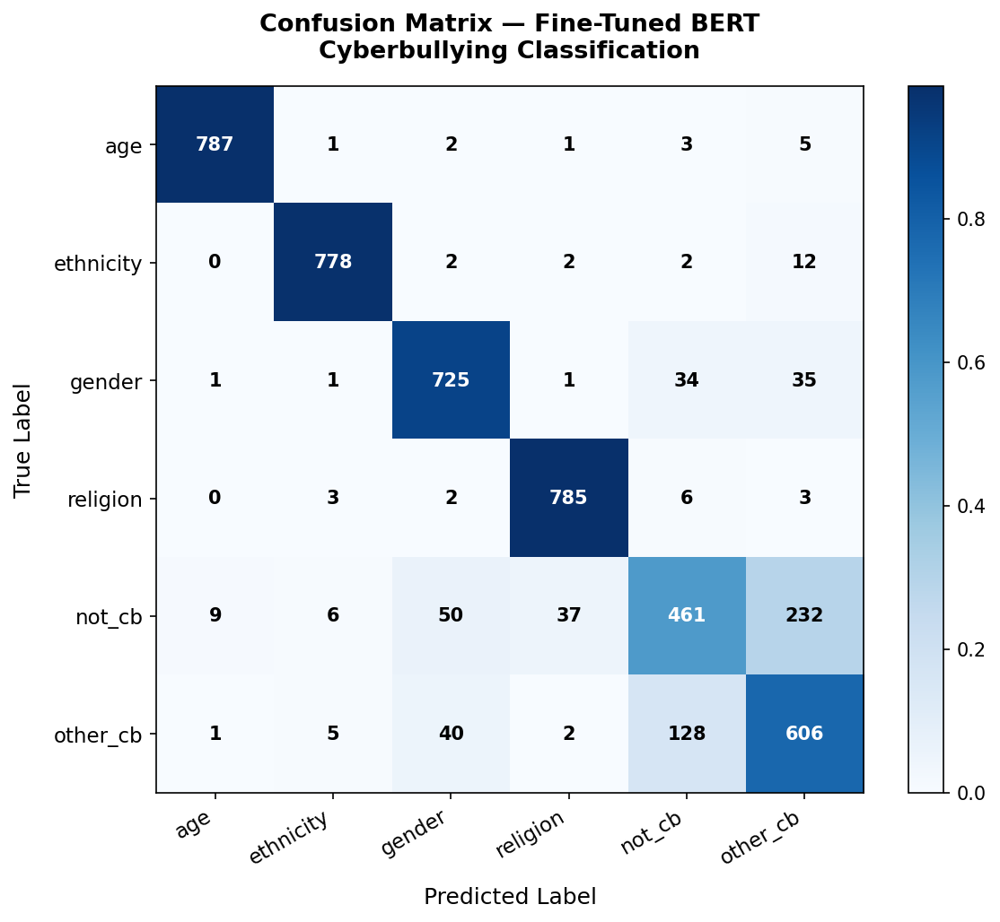

<div align="center">

# 🛡️ Cyberbullying Detection System

**A fine-tuned BERT model combined with rule-based analysis to detect, categorise and score cyberbullying in social-media text.**


</div>

---

## 📌 Overview

Online harassment is hard to moderate at scale. This system classifies a tweet or comment into one of
**six categories** and assigns a **threat level and severity score**, giving moderators more than a
simple yes/no answer.

It combines three signals:

1. **BERT toxicity score** — `bert-base-uncased` fine-tuned on a labelled cyberbullying-tweets dataset
2. **Rule score** — keyword and pattern analysis for each category
3. **Context mitigation** — reduces false positives for neutral or educational context

## 🏷️ Categories & Threat Levels

| Categories | Threat levels |
|---|---|
| `age` · `gender` · `religion` · `ethnicity` · `other_cyberbullying` · `not_cyberbullying` | `NOT_CB` · `LOW` · `HIGH` · `CRITICAL` |

## 📊 Results

Evaluated on a held-out, stratified test set of **4,768 samples** (80 / 10 / 10 split, seed 42).

| Metric | Score |
|---|---|
| Accuracy | **86.87 %** |
| Macro Precision | 0.867 |
| Macro Recall | 0.868 |
| Macro F1-Score | **0.866** |

| Class | Precision | Recall | F1 |
|---|---|---|---|
| age | 0.986 | 0.985 | 0.986 |
| ethnicity | 0.980 | 0.977 | 0.979 |
| religion | 0.948 | 0.983 | 0.965 |
| gender | 0.883 | 0.910 | 0.896 |
| other_cyberbullying | 0.679 | 0.775 | 0.724 |
| not_cyberbullying | 0.727 | 0.580 | 0.645 |

<p align="center"></p>

## ✨ Features

- Fine-tuning pipeline with validation-based checkpoint selection
- Separate, untouched test split for honest final evaluation
- Batched inference for fast evaluation
- Web interface: paste a text, get category, threat level, severity and score breakdown
- Model performance dashboard with confusion matrix and evaluation report

## 🧰 Tech Stack

Python · PyTorch · Hugging Face Transformers · Safetensors · Pandas · NumPy · HTML/CSS/JavaScript

## 📂 Project Structure

```text
├── train_cyberbullying_bert.py      # Fine-tuning pipeline
├── cyberbullying_detection_system.py# BERT + rules + context integrated system
├── evaluate_model.py                # Test-set evaluation & report
├── app.py                           # Web server for the interface
├── templates/ · static/             # Front end
├── cyberbullying_bert_model/        # Fine-tuned model & tokenizer
├── evaluation_report.txt            # Full metrics
└── confusion_matrix.png
```

## 🚀 Getting Started

```bash
git clone https://github.com/Ammarjm/cyberbullying-detection-system.git
cd cyberbullying-detection-system
git lfs pull                 # downloads the model weights
pip install -r requirements.txt
python app.py
```

Open **http://127.0.0.1:5000** in your browser.

## 👤 Author

**Ammar Alsabateen** — AI & Machine Learning Engineer
Faculty of Artificial Intelligence, Al-Balqa Applied University
[GitHub](https://github.com/Ammarjm) · [Email](mailto:alsabateenammar@gmail.com)
